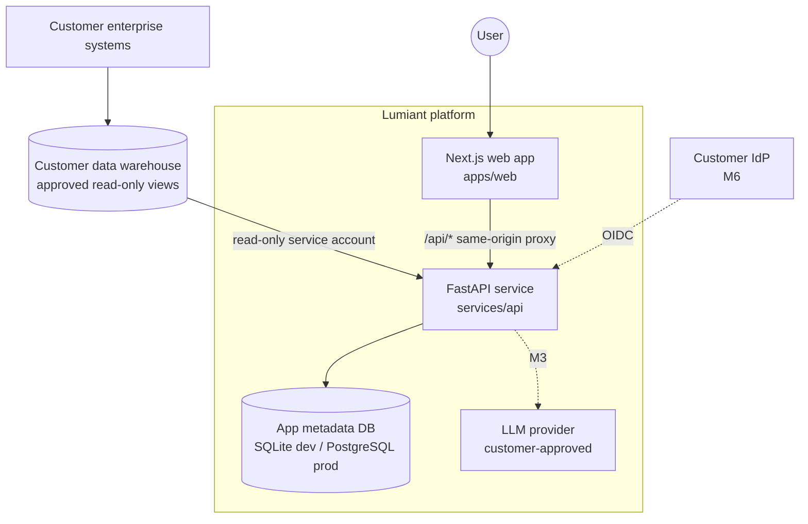

# Architecture

Status: **Designed**; M1 implementation in progress. Decisions are recorded as ADRs in `adr/`.

## 1. Context

During development the customer warehouse is replaced by **synthetic DuckDB files** (one per demo tenant), opened read-only.

## 2. Components (`services/api/src/lumiant/`)

| Module | Responsibility | Depends on |
|---|---|---|
| `core` | settings + env validation, JSON logging, error model, request context | — |
| `tenancy` | load + validate tenant YAML; registry of tenants | core |
| `auth` | `AuthProvider` interface, dev provider, `Principal`, permission + scope resolution, FastAPI deps | tenancy |
| `canonical` | canonical datasets, fields, types, roles, sensitivity, computed fields, approved joins | — |
| `mapping` | canonical → physical resolution per tenant (SQLAlchemy `Table` objects) | canonical, tenancy |
| `connectors` | connector protocol, `ResultSet`, DuckDB connector, per-tenant registry | core |
| `query` | `QueryPlan`, validator, compiler, sql_guard, executor, provenance | canonical, mapping, connectors, auth |
| `analyses` | named deterministic analyses (M1: below-reorder) | query |
| `metrics` | metric catalog (versioned plan templates) + service | query |
| `audit` | audit event model + store (app DB) | core |
| `synthetic` | deterministic data generator + writer + CLI | canonical, tenancy |
| `api` | HTTP routes only — no business logic | all above |

Rule: **routes never build SQL, never check permissions by hand, never touch connectors directly** — they call services that go through the validator.

## 3. Web (`apps/web`)

Next.js App Router. Pages fetch through a typed client (`src/lib/api.ts`) to same-origin `/api/*`, which `next.config.ts` rewrites to FastAPI. Session cookie is httpOnly (set by FastAPI). `src/proxy.ts` (Next 16's replacement for middleware) redirects unauthenticated users to `/login` — a UX convenience only; the API enforces everything.

## 4. Key flows

See `00-context/CONTEXT_FLOW.md` §A for the step-by-step request flow and `QUERY_ENGINE.md` for the query core.

## 5. Tenancy model

- Tenant config = YAML file per tenant (ADR-0006). Contains: identity, data classification (`synthetic`/`customer`), connection (type + path or `secret_ref`), mapping, freshness source, departments, warehouse→department, roles→permissions, dev users (dev only), policies (row limits, timeouts, staleness threshold).
- Tenant id comes **only** from the authenticated principal.
- Each tenant has its own connector engine → no shared connection can reach another tenant's data.
- Current deployment assumption: one deployment may host several tenants in dev; production may be single-tenant per deployment (A-007). Both work with this design.

## 6. Data stores

| Store | Purpose | Dev | Prod |
|---|---|---|---|
| Customer warehouse | Inventory data (read-only) | DuckDB synthetic files | Customer DB via approved connector (M7) |
| App metadata DB | audit events (M1); users, saved views, chat history, mappings history (later) | SQLite file `services/api/var/app.db` | PostgreSQL (untested locally) |

## 7. Cross-cutting

- **Money & quantities**: `Decimal` in Python; strings in JSON; never float. Aggregations grouped by currency/UoM.
- **Errors**: `{error: {code, message, request_id}}`; internal detail only in server logs (no secrets).
- **Logging**: JSON lines with request_id, user_id, tenant_id, route, status, duration; no values, no tokens.
- **Config**: `pydantic-settings`, prefix `LUMIANT_`; startup validation fails fast.
- **Time**: UTC everywhere; dates as ISO-8601.

## 8. Deployment topology (target, M6)

Two containers (web, api) behind the customer's reverse proxy/TLS terminator, PostgreSQL for app metadata, network path to the warehouse, optional egress to an approved LLM endpoint. Configurable for private cloud / on-prem. See `06-operations/DEPLOYMENT.md`.

## 9. Extension points

| Need | Extend |
|---|---|
| New customer DB | implement connector + register dialect; add to support matrix only after tests |
| New customer schema | new tenant YAML mapping; no code change |
| New metric | metric catalog entry (versioned) |
| New analysis | `analyses/` module + tests + capability requirements |
| New auth | `AuthProvider` implementation |
| New LLM | `LLMProvider` adapter (M3) |
