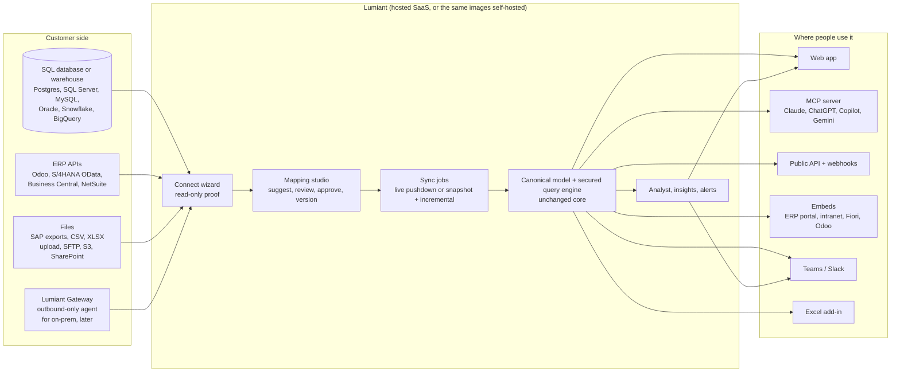

# Product v3 Plan: Connect, Use Anywhere, Command Centre

_Status: **approved by the owner 26 Nov 2026; V0 done (DEC-032), V1 and V4 next.** Builds on `PRODUCT_V2_PLAN.md` (P1 to P3 done),
`../ENTERPRISE_DATA_ACCESS_AND_TRUST.md`, `../ERP_INTEGRATION_ANALYSIS.md`, `../AI_SCHEMA_DISCOVERY.md` and
`../TECHNICAL_BOTTLENECKS.md`. Nothing here changes ADR-0002: the AI never writes SQL and never produces numbers._

Owner's ask: "plan it so businesses can use it as a plugin, or the best way to connect their database and use our
software; improve the UI/UX and all visuals; act as a senior engineer and find everything that can be improved."

---

## 1. Honest starting point (verified 26 Nov 2026)

| Area | Today | Why it blocks real businesses |
|---|---|---|
| Connecting data | One connector: DuckDB file (`connectors/registry.py`). Tenant config only accepts `type: duckdb` (`tenancy/models.py:30`). Real data only via the SAP XLSX importer | A business cannot connect anything itself |
| Onboarding | Tenants, warehouses, roles and mappings are YAML files in the repo (ADR-0006) | Every new customer needs a developer and a deploy |
| Mapping | Hand-written YAML; the `nomap` prototype can discover schemas and apply SAP/Odoo packs but is not wired in | No guided way to map an unknown schema, no approval trail |
| Refresh | Static files, no scheduler, no background jobs | Data goes stale; long analyses hold request threads |
| Ways to use it | Web app only (plus the internal REST API the web app uses) | People live in Excel, Teams/Slack, their ERP and their own AI assistant |
| Scale | ABC refuses above 1,000 items, cost comparison above 1,000 movements, filter lists cut at 100, offset paging, Overview repeats queries | Fails on a normal mid-size company |
| Correctness | Open bugs: #44 Analyst drops filters when a grouping rule matches, #45 "lots" counts stock lines, #46 warehouse missing from config silently changes totals, #47 no stale-data warning, #49 SQL Server plans without ORDER BY cannot compile | Wrong or misleading numbers are worse than missing features |
| Visuals | Strong kit (12 chart types, `/design`), but the Overview has no time series, no Material 360, no alerts centre, no global filters | Feels like a report, not a command centre |
| Product basics | Dev sign-in only, no SSO/SCIM, no settings page, no usage metering, no Helm chart, live Gemini never run | Cannot be sold or operated yet |

---

## 2. The recommendation in one picture

**Data in:** three doors, picked by where the customer's data lives (section 3).
**Data out:** the web app plus "plugins" that all call the same typed, scoped tools (section 4). One engine, many
surfaces: a number in Excel, Teams or Claude is the same number, with the same provenance and permissions, as in the app.

---

## 3. Connecting a business's data (the "best way")

### 3.1 Which door for which customer

| Customer situation | Best path | Why |
|---|---|---|
| Cloud database or warehouse reachable over the internet (RDS, Azure SQL, Cloud SQL, Snowflake, BigQuery) | **Direct read-only connection** from hosted Lumiant: IP allowlist or private link, a dedicated read-only user on approved views | Fastest to start (minutes), no install, queries push down |
| ERP with an API but no direct DB access (Odoo Online, S/4HANA Cloud, Business Central, NetSuite) | **ERP connector**: extract to an isolated per-tenant snapshot on a schedule, incremental by change date | SQL is not allowed or not exposed; the snapshot reuses today's validated DuckDB path |
| On-premises database behind a firewall (SAP ECC/HANA, SQL Server, Oracle) | **Self-hosted Lumiant** (Model B) now; **Lumiant Gateway** later | No inbound firewall hole; the gateway is an outbound-only container like the Power BI gateway. Build it only when several customers need it (`ENTERPRISE_DATA_ACCESS_AND_TRUST.md` stage 4) |
| Not ready to connect anything | **Files**: upload or scheduled drop (SFTP, S3, SharePoint) of SAP exports or CSV | Already proven with the client's SAP exports; zero access risk |

All four land in the same place: a tenant with an approved, versioned mapping onto the canonical model.

### 3.2 Connector contract v2

Adopt the design already written in `ERP_INTEGRATION_ANALYSIS.md` §4:

- `Source` (all): `capabilities()`, `test_connection()`, `assert_read_only()` (tries a write, expects refusal),
  `discover()` (tables, columns, keys, comments, row estimates).
- `SqlSource`: today's `execute(Select)` with server-side cancel. Pushdown for Postgres, SQL Server, MySQL, Oracle,
  Snowflake, BigQuery.
- `ExtractSource`: `extract()` yields record batches into the tenant snapshot. Odoo JSON-2, S/4HANA OData, files.
- **Conformance suite in CI** against real engines in containers (Postgres, SQL Server, MySQL) loaded with the
  synthetic datasets: read-only proof, timeout cancels server-side, DECIMAL exactness, dates and NULLs, golden totals
  equal the DuckDB totals, drift detection. Only a connector that passes is called "supported". Fixes #49 on the way.

### 3.3 Onboarding flow (the hero UX for business adoption)

1. **Choose source** (cards with plain icons: Postgres, SQL Server, Snowflake, Odoo, SAP files ...).
2. **Connect**: form with inline help, "Test connection", then **read-only proof** shown as a green check.
   Credentials go to the secret store (encrypted, never shown again, never logged).
3. **Discover**: progress while metadata is read (no row data). Reuse `nomap/discovery.py` structure reading and the
   SAP/Odoo packs as **suggestion sources only**.
4. **Map** in the Mapping Studio: each canonical field shows the suggested column, sample profile (counts, nulls,
   min/max, never raw values without approval), a confidence chip and the reason. Bulk-approve high confidence,
   review the rest. A named person approves; the mapping becomes version N.
5. **Validate**: grain, orphan and join checks plus **reconciliation against the customer's own report**
   (`/api/admin/reconciliation` already exists). Totals must match before go-live.
6. **Go live**: first sync, freshness SLA per dataset, drift check on a schedule. Any drift reopens review.

Order of build follows `AI_SCHEMA_DISCOVERY.md` §9: metadata capture and the validation harness first, AI suggestions
last. An impressive AI mapper with no proof of correctness is the expensive mistake.

### 3.4 What has to change underneath

| Change | Detail |
|---|---|
| Tenant config from YAML to the database | Workspaces, sources, warehouses, roles and mapping versions become DB records with an approval trail. YAML stays as import/export so demo tenants and GitOps keep working. New ADR (supersedes part of ADR-0006) |
| Secret store | Envelope encryption in the app DB with a master key from the environment or a cloud KMS; `secret_ref` adapters for Azure Key Vault, AWS Secrets Manager, GCP Secret Manager later |
| Background jobs | A Redis-backed worker (Redis is already in the stack) for syncs, discovery, insight precompute and scheduled reports; cancellation and retries; job status in the UI |
| Sync modes | Live pushdown (small or fast sources) or snapshot + incremental by watermark (default for ERPs and big tables). Per-dataset freshness shown everywhere |
| Per-tenant fairness | Concurrency limit with queueing and a friendly "busy" state instead of a 500 (TECHNICAL_BOTTLENECKS P1) |

---

## 4. "Plugins": using Lumiant where people already work

All surfaces call the same typed tools (`query_inventory`, metrics, analyses, `search_knowledge`, insights) with the
caller's own role and warehouse scope. No surface gets a new path to the data.

| Surface | What a business gets | Effort | Priority |
|---|---|---|---|
| **Public API v1 + service accounts** | Stable, versioned REST API with OpenAPI docs, API keys per service account with scopes, rate limits, audit | M | **1** (everything below builds on it) |
| **MCP server** | Their own AI assistant (Claude, ChatGPT, Microsoft Copilot, Gemini) can ask Lumiant inventory questions through OAuth; answers carry provenance. Our typed tools map 1:1 to MCP tools, so ADR-0002 holds | S to M | **1** (highest leverage, smallest build) |
| **Webhooks + alert rules** | "Tell me when item X drops below reorder", "daily digest of new risks", pushed to any URL | M | **2** |
| **Embeds** | `<lumiant-widget>` web component or iframe with a short-lived signed embed token: a KPI tile, chart or Analyst box inside an ERP portal, intranet, SAP Fiori launchpad tile or an Odoo dashboard | M | **2** |
| **Microsoft Teams and Slack apps** | Alert cards, daily digest, "ask the Analyst" from chat with the user's own permissions | M | **3** (needs the owner's test workspace) |
| **Excel add-in** | Planners pull live tables and functions such as `=LUMIANT.STOCK("ITEM-104","3100")` with refresh, scoped to the user | L | **3** |
| **Power BI / Tableau feed** | OData feed of canonical metrics for BI teams | M | 4, on demand |
| **Odoo app, SAP BTP extension, Snowflake Native App** | Distribution inside those ecosystems (Snowflake: runs next to the data, zero copy) | L each | 5, only with a paying customer asking |

---

## 5. UI/UX and visuals

Principles stay: numbers are geometry only and printed values are the API's exact strings; status always has icon +
words; no AI tint; Obsidian dark and ivory light; Newsreader titles, Inter numbers.

### 5.1 New screens

| Screen | What it does |
|---|---|
| **Connect data** wizard | Section 3.3, with a step rail, live checks, plain-language errors ("the user can write to table X: use a read-only user") |
| **Mapping Studio** | Two-pane mapper: canonical fields left, source columns right with profiles and confidence; diff between mapping versions; approve button with name and time |
| **Data sources** | One card per source: status, last sync, next sync, rows, freshness against SLA, drift, a sync-history timeline (closes ISSUES #39 rest, UX-17) |
| **Executive command centre** (v2 P4) | Hero KPIs with sparklines and deltas, 12-month value trend, insight feed, treemap, Pareto, value by warehouse, planning tiles (fulfilment risk, shortages, supplier on-time) |
| **Inventory grid + Material 360** (v2 P5) | Virtualised server-paged grid (keyset paging, sticky header and first column, column chooser, density), Material 360 drawer: stock by warehouse, movement timeline, cost waterfall, lots and expiry, where-used, suppliers, open orders, provenance |
| **Alerts centre** | Bell with unread count, rules editor, snooze, digest preview; feeds webhooks, Teams and Slack |
| **Settings** | Theme, locale, number format, default warehouse, notifications, API keys, connected apps |
| **Integrations gallery** | MCP, API keys, embeds (copy snippet with live preview), Teams, Slack, Excel |

### 5.2 New visuals (added to the chart kit, all with a data-table fallback)

| Visual | Answers |
|---|---|
| Stock flow (Sankey) | Receipts → stock by warehouse → issues, scrap, transfers: where does stock go? |
| Ageing buckets (stacked bars, clickable) | 0–90, 91–180, 181–365, 365+ days, by value |
| ABC–XYZ matrix | Value class against demand variability: what to stock tightly, what to make to order |
| Days-of-cover bullets | Cover per item against target and lead time |
| Service level vs inventory curve | What extra stock buys in service level (deterministic math, flagged as a model) |
| Forecast fan chart | Statistical demand forecast with ranges (deterministic model, labelled as a forecast, never AI numbers) |
| Warehouse map | Value and risk per site on a simple map (no third-party tiles without approval: SVG outline or plain grid) |
| Cycle-count accuracy trend | Counted vs book, by warehouse |

### 5.3 Cross-cutting UX

- **Global filter bar** (warehouse, period, currency) stored in the URL, so every view is shareable and back works.
- **Saved views** server-side, shareable within the workspace.
- **Drill-through everywhere**: every number opens its rows; every row opens Material 360.
- **Analyst**: inline charts in answers, conversation threads, number chips linked to source rows, export answer.
- **States**: skeletons that match final layout, illustrated empty states with the next action, never raw errors.
- **First-run tour** (4 steps) and a demo workspace for trials, clearly labelled SYNTHETIC.
- **Mobile**: card rows for tables, PWA install, alerts readable on a phone.
- **Accessibility**: axe in e2e with 0 serious/critical, full keyboard pass, contrast gate in both themes.
- **Visual regression**: Playwright screenshots of key screens in both themes so a palette change can never again
  ship unseen.

---

## 6. Senior-engineer review: everything else that should improve

| Priority | Item | Fix |
|---|---|---|
| **P0** | Correctness bugs #44, #45, #46, #47, #49 | Fix with regression tests before any new feature |
| **P0** | Scale limits (ABC 1,000 items, cost 1,000 movements, filter lists 100) | ABC and Pareto as SQL window functions; streamed FIFO; searchable filter endpoints with truncation notices |
| **P0** | Overview query chattiness | One batch endpoint, shared below-reorder result, per-tenant cache keyed by mapping version + scope + freshness |
| **P1** | Live Gemini never run (ISSUES #13, #56) | Owner's key on a synthetic tenant; record latency, tokens, cost per question; per-tenant budget |
| **P1** | Offset paging, `contains` scans | Keyset paging; prefix or indexed item search |
| **P1** | Long requests on the threadpool | Worker jobs with cancellation (section 3.4) |
| **P1** | Real sign-in | OIDC with a real IdP (Q-010), then SAML and SCIM for enterprises; MFA through the IdP |
| **P1** | Performance budgets never measured (v2 §7) | Baseline LCP, route change, bundle size, API p95; budget checks in CI |
| **P2** | Observability | OpenTelemetry traces API → connector → source; web vitals; error capture to our own log (no third party without approval) |
| **P2** | Deployment | Helm chart and Terraform module for self-hosted, signed images, SBOM, backup and restore drill (`BACKUP_AND_RECOVERY.md`) |
| **P2** | Dependency upgrades (ISSUES #2, #8) | TS, DuckDB, SQLAlchemy review; `httpx` test client deprecation |
| **P2** | Audit write cost | Batch per request, keep fail-closed |
| **P3** | Usage metering and plans | Count queries, Analyst calls, connected sources per workspace; billing only once pricing exists |
| **P3** | Security assurance | External pen test, then a SOC 2 readiness path when a customer requires it |

---

## 7. Phases

Each phase ends with tests, a browser check in both themes, logs, and a push to `feature/product-v2` (or a new
`feature/product-v3`). Every connector is tested **only against local containers loaded with synthetic data**;
connecting to any real customer system still needs the owner's written authorization (project hard rule).

| Phase | Scope | Size | Depends on |
|---|---|---|---|
| **V0 · Correctness and speed** ✅ done 26 Nov 2026 (DEC-032) | §6 P0 items; perf baseline; visual regression + axe in e2e | M | nothing |
| **V1 · Connect** (partly done 26 Nov: generic read-only SQL connector + conformance suite, Data source tab with connection test, encrypted connection store (DEC-034); open: tenant config in DB, worker and sync jobs, Connect wizard) | Connector contract v2; Postgres, SQL Server, MySQL connectors with the conformance suite; tenant config in DB with YAML import/export; secret store; worker and sync jobs; Connect wizard; Data sources page | L | V0 |
| **V2 · Map and trust** (partly done: name-based mapping suggestions matching all four demo mappings, validation harness, Mapping and Validation tabs; open: stored versions and approval in the app, drift schedule) | Metadata snapshots, validation harness, mapping versions and approval, Mapping Studio, drift schedule; then pack and AI suggestions for what is unmapped | L | V1 |
| **V3 · Use anywhere** (mostly done: API keys, public API through keys, MCP server, Integrations tab, alert rules with signed webhooks and scheduled sending (`lumiant-alerts send-due`); open: embeds, Alerts centre in the shell) | Public API v1 + service accounts; MCP server; webhooks + alert rules + Alerts centre; embeds with signed tokens; Integrations gallery | L | V0 (API), V1 (alerts on synced data) |
| **V4 · Command centre and visuals** (partly done: 12-month value trend, Material 360, stock ageing buckets, saved views; S11: Analyst inline charts, month/quarter/year bucketing in the query engine; open: grid virtualisation, other §5.2 visuals, global filters, multi-series period charts) | v2 P4 (time-bucket metric, 12-month synthetic history, command centre), v2 P5 (grid + Material 360), §5.2 visuals, global filters, saved views, Analyst inline charts | L | V0 |
| **V5 · Product foundations** (partly done: Settings page, first-run welcome card; open: the rest) | Real IdP, SSO/SCIM, settings, first-run tour, trial workspace, observability, Helm chart | M to L | owner decisions |
| **V6 · Ecosystem** | Teams/Slack apps, Excel add-in, Snowflake/Databricks options, Odoo app, Gateway agent | L each | demand |

**Suggested order:** V0, then V1 and V4 in parallel (API vs web), then V2 and V3, then V5. V6 only with demand.

---

## 8. Decisions for the owner

| # | Question | Proposed default |
|---|---|---|
| E1 | Main delivery model | **Hosted SaaS with direct read-only connections**, plus the same images self-hosted for on-prem customers. Gateway agent later |
| E2 | First connectors | **PostgreSQL, SQL Server, MySQL** (testable locally in containers), then Snowflake/BigQuery, Odoo, S/4HANA OData |
| E3 | Move tenant config from YAML into the database (YAML kept as import/export) | **Yes** (new ADR) |
| E4 | First "plugin" surfaces | **Public API + MCP server**, then embeds and webhooks, then Teams/Slack and Excel |
| E5 | Job runner | **Redis-backed worker** (Redis is already optional in the stack) |
| E6 | Secret store | **Encrypted in the app DB** with a master key from the environment now; cloud vault adapters later |
| E7 | AI-suggested mappings send column names and aggregate profiles (never row values) to Gemini, synthetic tenants only until Q-013 | **Yes**, off by default per tenant |
| E8 | Start order | **V0 now**, then V1 + V4 |
