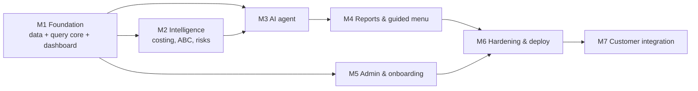

# Roadmap

Ordered by dependency. Each milestone ends with tests passing, docs synced, and `CURRENT_STATE.md` rewritten.

| M | Name | Contents | Depends on | Blocked by customer? |
|---|---|---|---|---|
| M1 | Foundation | Knowledge base, API core, tenant config, canonical model, mapping, synthetic data, DuckDB connector, query core (validator/compiler/guard/executor/provenance), audit, dev auth + RBAC, overview + inventory UI, tests | — | No |
| M2 | Intelligence engine | MWA, periodic WA, FIFO layers, lot cost, latest-price definitions, computed vs assigned ABC, excess/slow/dormant/ageing/expiry/master-data/price-movement analyses, item-code parser, financial fixtures | M1 | Definitions need approval (Q-005–Q-008) — demo with draft definitions |
| M3 | AI agent | Provider abstraction, tool catalog, bounded loop, grounding guard, clarification, glossary, capability matrix, injection defenses, disclosure log, eval harness, chat UI | M1, M2 | Provider approval (Q-013) for real data; dev with synthetic data |
| M4 | Reports & guided menu | Guided analysis launcher, report builder, saved views, drill-through, CSV/XLSX export, print view, chips | M3 | No |
| M5 | Admin & onboarding | Schema discovery, profiling, mapping studio, reconciliation harness, permission-matrix UI, audit explorer, value maps | M1 | No (synthetic), yes for real schemas |
| M6 | Hardening & deploy | OIDC, rate limiting, Postgres app DB, containers, OpenTelemetry, CI with audits/secret scanning, prod-readiness checklist, runbooks | M4, M5 | IdP (Q-010), hosting (Q-012) |
| M7 | Customer integration | Real connector, schema mapping, reconciliation vs authoritative reports, performance, digests/watchlists | M6 | Yes (Q-001–Q-003, authorization) |
